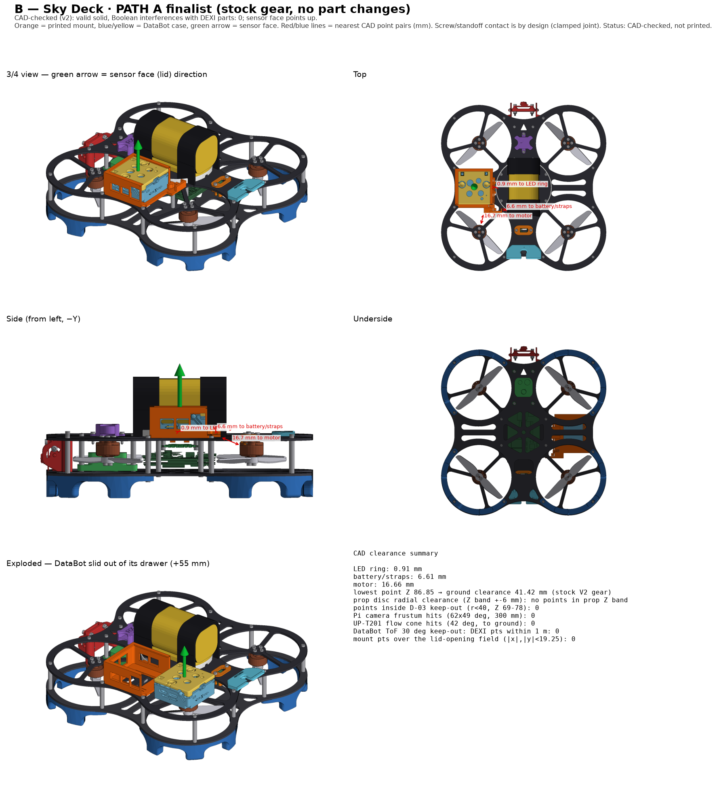

# DEXI 3 DataBot Mount

Mounts for a **databot 2.0** (42.5 × 42.5 × 20 mm, 34 g) on the DEXI 3. Two options:

| Option | Where | Sensors face | Needs | Added mass* |
|---|---|---|---|---|
| **Sky Deck** — no changes to the drone | top plate, left side, clips into the existing waist slots | up (ceiling distance, UV, light, fresh air) | nothing — no screws | ≈ 44 g |
| **Belly Tray** — best balance | under the bottom plate, centred on the centre of gravity | down (height above ground, ground colour) | the **1.25 in landing gear** (stock gear leaves 3.8 mm too little room) + 4 screws | ≈ 58 g incl. gear |

\*DataBot + printed parts (+ gear change for the Belly Tray), from slicer masses — not weighed.

## Status

**CAD-checked only — not yet printed, fit-tested or flown.** Checked in CAD against the DEXI 3 V2 frame plates,
Battery Mount V3 and Landing Gear .5 in V2: no interference with any part, nothing in the propeller zone, and nothing
blocking the Pi camera, the flow sensor or the DataBot's sensor openings. Please report fit and print results on #27.

## Files

| File | Part |
|---|---|
| `DEXI 3 DataBot Sky Deck.step` / `.stl` | Sky Deck drawer (clips into the top-plate waist slots) |
| `DEXI 3 DataBot Belly Tray.step` / `.stl` | Belly Tray drawer (4 inner-standoff screws) |
| `DEXI 3 Landing Gear 1.25 inches.step` / `.stl` | Taller gear for the Belly Tray — print **4**; same screw holes as the .5 in gear |

STLs are already in print orientation.

## How the DataBot is held

The DataBot slides into a drawer: rails grip the flat rim of its lid on the two straight sides and one printed-flat
flexure latch clicks behind it. Press the latch tab and slide it out. Lid openings, side vents, USB port and power
switch stay uncovered. **Logging without a phone:** switch the DataBot on face-down (Server/Wi-Fi logging mode), then slide it in.

## Printing (Bambu P2S, 0.4 mm nozzle)

| Part | Material | Settings | Supports |
|---|---|---|---|
| Sky Deck | PETG HF | 0.20 mm, **Arachne** walls, 4 walls, 5 top / 4 bottom, 30 % gyroid, Textured PEI | tree, build plate only |
| Belly Tray | PETG HF | same | paint supports **only under the two side rails**; keep the latch gaps clear |
| Landing gear 1.25 in (×4) | TPU for AMS | 2 walls, 3 walls between 3.8–13 mm height, 15 % infill | none |

## Hardware (Belly Tray only)

Replaces the 4 inner-standoff **bottom** M2×8 screws, one at a time (never loosen the top screws):
- 2 × **M2×10 countersunk, 90° (DIN 7991)** — the two screws on the drone's right side, 0.05 N·m, seat hand-reamed with a 90° countersink
- 2 × **M2×10 socket head (ISO 4762)** + 2 × **M2 flat washer (ISO 7089, 2.2 × 5 × 0.3)** — left side, 0.08 N·m
- Medium (blue) threadlocker on the screw tips only, never on the plastic

Landing gear reuses its stock screws.

## Testing without a DataBot

The fit can be checked with a printed stand-in case made from the databot enclosure STEP files (same outer shape;
add ~34 g if checking balance). Retention, latch feel, clearance on the drone and the gear drop test do not need a real DataBot.
