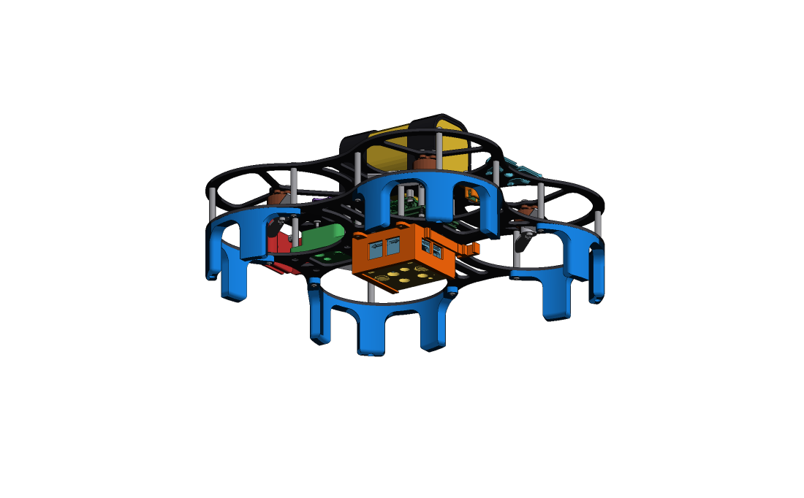
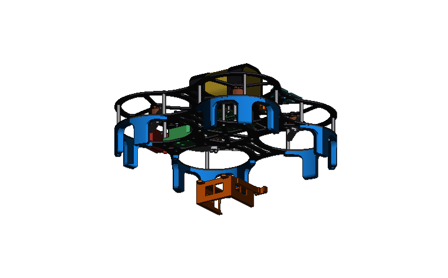
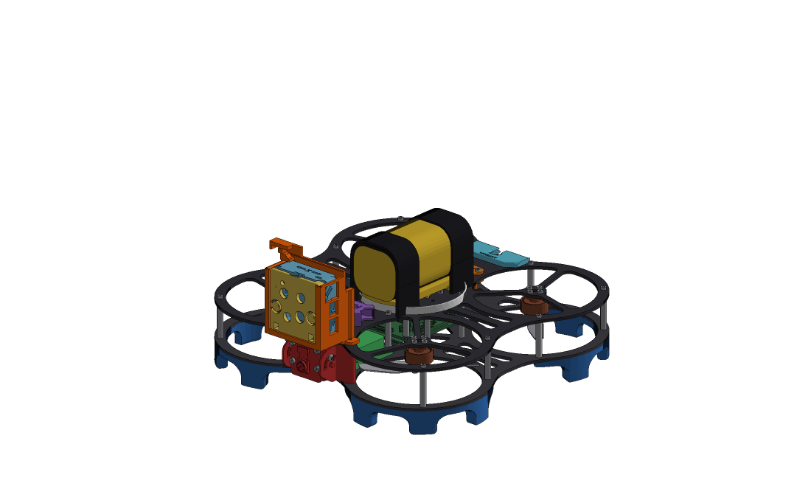
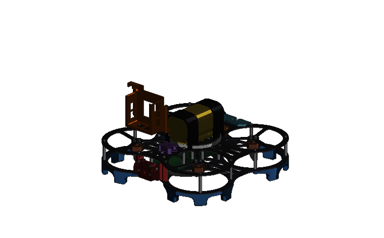

# DEXI 3 DataBot Mount

Two ways to mount a databot 2.0 on the DEXI 3.

| File | What it is |
|---|---|
| `DEXI 3 DataBot Belly Mount.step` | Mount under the drone — sensors face down. Screws to the 4 inner standoffs. |
| `DEXI 3 Landing Gear 1.25 inches.step` | Taller landing gear needed for the Belly Mount (print 4). |
| `DEXI 3 DataBot Forward Facing Mount.step` | Mount on the front of the top plate — sensors face forward. |

The DataBot slides into either mount and clicks in place.

## Belly Mount

## Forward Facing Mount

